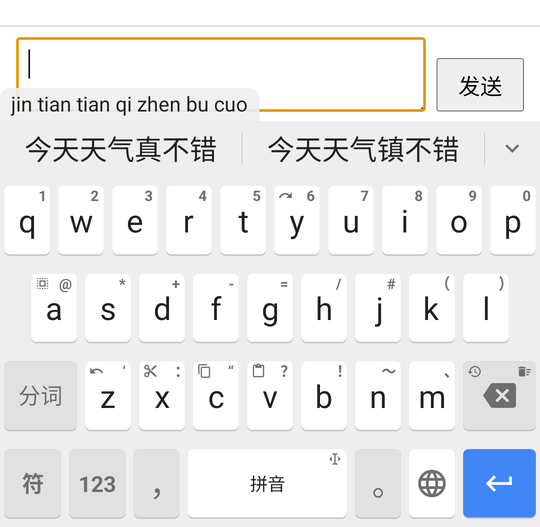
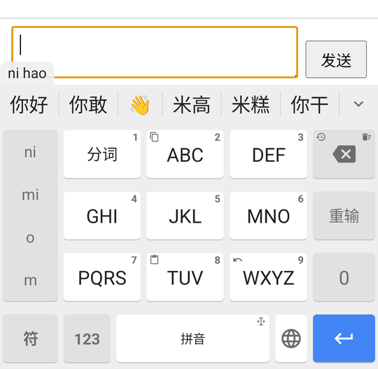
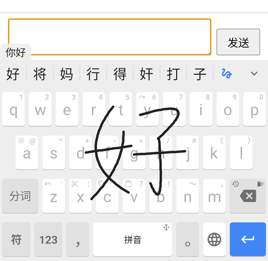
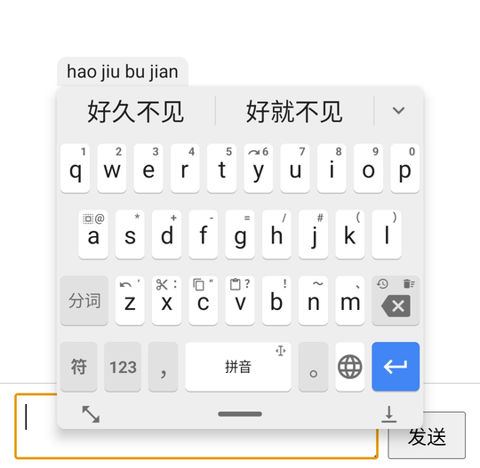
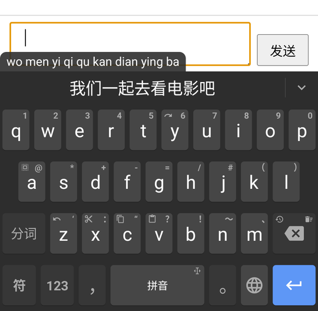

<h1 align="center">幽默输入法 · Youmo IME</h1>

<a href="#幽默输入法">中文</a> · <a href="#youmo-ime">English</a> · <a href="docs/README.md">使用说明</a> · <a href="CHANGELOG.md">版本日志</a> · <a href="https://github.com/Sraw/youmo-ime/releases/latest">下载</a>

---

## 幽默输入法

**完全离线**的 Android 中文输入法：拼音、九键、双拼、五笔等码表、手写、英文，导入语音包后还能离线语音输入。
不申请网络权限，打的字、说的话都不会离开手机。

> 从 [fcitx5-android](https://github.com/fcitx5-android/fcitx5-android) 分出；[Fcitx5](https://github.com/fcitx/fcitx5) 框架已用 Kotlin 重写进本项目，
> 设置仍沿用 Fcitx5 的配置文件。拼音引擎、语言模型和句子模型是自己做的。与 Fcitx5 官方无关，不会合并回上游，问题请在[本仓库](https://github.com/Sraw/youmo-ime/issues)反馈。

### 特色

- **整句拼音**：全拼和双拼（小鹤、微软、自然码），键盘可选全键盘、18 键、两个字母一个键的 14 键或九键（按 `64426` 就是"你好"），也能用注音九键、大千注音全键盘打；简拼、半截输入；中英混输（九键、14 键、18 键按英文字母所在的键也打得出）；点偏到相邻键时看点在键上的哪儿，自动纠正。
- **笔画筛选**：打了拼音后在键盘上画一笔（横、竖、撇、点、折），只留第一个字这样起笔的候选，再画就按笔顺接着筛，不用翻页找字（默认关，和滑行输入二选一）。
- **自己训练的模型**：拼音和英文的 n-gram 模型从网页统计而来；两个小型句子模型参考前文，给整句重新排序，按手机处理器自动选用多少计算，候选在按键当时排好、不会停顿后跳动。
- **新词**：近几年的新词（显眼包、破防、红温……）逐个校对后收进词库，每次发版更新。
- **手写**：点工具栏的「手写」，直接在拼音、码表、注音键盘的字母上写字，再点一下关掉；一次写一个字，按整句理解，后写的字能改正前面认错的。
- **字卡和词卡**：长按任何中文候选，菜单第一行是读音，点开看字卡（读音和例词、部首、笔顺）或词卡（整个词的拼音和注音、每个字的读音）。候选上可以标出拼音或注音（默认关）。
- **码表**：五笔、仓颉、二笔、自然码、五笔拼音；重码按前文排，上屏后有联想；按偏的键接不上时看落点改读；逐字打出的词点一下就记住成词。
- **英文键盘**：自动纠错（按偏的键看落点）、补全、预测下一个词。
- **生僻字屏蔽**：按《通用规范汉字表》分组，把不想看到的生僻字从所有中文候选、联想和语音结果里挡掉，可以整组挡，也可以一个个挑（默认关）。
- **滑行输入**：英文、拼音、九键、码表都能一笔划出一个词（默认关）。
- **剪贴板、工具栏、输入框**：剪贴板条目能切成一块块，点选或横着滑选后拼起来上屏，历史可以不限条数，常用的收藏起来一直留着；工具栏的按钮和顺序自己定；数字、电话框直接出数字键盘，数字键盘和九键左边那列符号能自己改，网址、邮箱框给常用后缀和打过的邮箱。
- **主题、长按和滑动、编辑菜单**：在网页主题制作页做主题（渐变、动态背景、按键音、自己的图标），也能导入百度、搜狗、讯飞、同文、FlorisBoard 的皮肤（网页制作页也能打开它们接着改），主题还能带一只跟着打字动的小宠物，带 12 个新内置主题；每个键的长按、上滑、下滑在一页里改，所有键盘通用；空格上滑出全选、复制、粘贴、撤销，退格上滑清除、下滑恢复，滑选能跨行选字。
- **表情和小工具**：候选里给出对应的表情，表情面板按拼音搜索；快速输入存自己的常用语，什么都没打时点一下上屏；u 开头按部件拆字，算式后打 = 出结果，rq/sj/xq 出日期时间。
- **自己的键盘布局**：在网页布局编辑器里拖键、改宽、合并键，做成 17 键、AZERTY 之类的布局，导入后给拼音、双拼、英文、码表打字用，数字键盘、符号面板也能换。
- **分体、单手、悬浮键盘，实体键盘**：竖屏、横屏各选普通、分体、悬浮或单手；悬浮键盘能拖动、调大小；折叠屏展开、平板竖拿按横屏排；接实体键盘时候选显示在光标旁。
- **边打边学**：记住你选的词和顺序，常用的排到前面；上屏过几次的整段话，打出开头就接着给出剩下的；能导入搜狗等输入法的词库；常用词能自己排到最前；长按候选可以删除、固定、屏蔽，做错了马上撤销；学到的东西自动备份，换手机能恢复。
- **离线语音**（要导入语音包）：按住空格说话，或点麦克风说话，边说边出字，可以中英混说；自动去掉口头禅、加标点，数字按习惯写；带口音的普通话也能识别。说完马上松手也不丢最后一个字，小声说也听得出；说话时暂停别的应用在放的音乐；你的同音词看整句换上，语音写错的词改对以后问一句要不要记住。目前只支持普通话和英语，还不支持方言。

每项功能和设置的详细说明见[使用说明](docs/README.md)。

### 效果

拼音首选正确率（%），2026-11-23 测，开着相邻键纠错（App 默认如此）：

| | 主集 | 近期网页 | 聊天 | 对话 | 新词 |
|---|---|---|---|---|---|
| 只用 n-gram | 88.5 | 72.7 | 68.7 | 67.6 | 79.5 |
| 加句子模型（中档） | 90.9 | 76.5 | 71.4 | 71.0 | 78.8 |
| 加句子模型（高档） | 91.6 | 77.5 | 73.3 | 71.5 | 79.3 |

九键打主集 87.9%。英文每 25 个键按错一个时，73.8% 的错词能自动改对。

新键盘在聊天集上（只算每个键序只有一种拼法的句子，所以和上表不能直接比）：14 键 61.1%，按左右半边点时 66.2%（点得偏一点）到 67.7%（点得准）；小鹤双拼 18 键 63.6%、14 键 51.9%、九键 31.5%；九键全拼 53.9%。各键盘留下的句子不完全相同。

### 下载

到 [Releases](https://github.com/Sraw/youmo-ime/releases/latest) 下载最新版：文字版（安装包 + 文字包）约 320 MB，语音版（再加语音包）约 495 MB。
需要 Android 10 以上的 arm64 手机。安装包约 21.9 MB，模型和词库在资源包里，装好后在 **设置 → 资源包** 导入（见[安装与上手](docs/getting-started.md)）；资源包没有新版本时，升级只要下安装包。持续更新中，词库每月更新一次。

### 下一步计划

- **改进语音识别**：用真实的口音录音继续改进带口音的普通话，再支持粤语等方言。

### 许可与数据

- 代码：LGPL-2.1-or-later。构建方法见 [BUILDING.md](BUILDING.md)；[隐私政策](PRIVACY.md)。
- 词典、码表和拼音模型的基础来自 [libime](https://github.com/fcitx/libime)（LGPL-2.1-or-later），笔画表来自 [rime-stroke](https://github.com/rime/rime-stroke)（LGPL-3.0-only）。
- 候选词注音的声调：字来自 Unicode 的 [Unihan](https://www.unicode.org/charts/unihan.html)（Unicode-3.0），经 [mozillazg/pinyin-data](https://github.com/mozillazg/pinyin-data)（MIT）整理；词来自 [mozillazg/phrase-pinyin-data](https://github.com/mozillazg/phrase-pinyin-data)（MIT），本项目校订（`lexicon/tones.tsv`）。
- 表情列表来自 Unicode 的 [emoji-test.txt](https://www.unicode.org/Public/17.0.0/emoji/emoji-test.txt)，表情的中文关键词来自 [CLDR](https://github.com/unicode-org/cldr)（均为 Unicode-3.0）。
- 繁简转换的数据来自 [OpenCC](https://github.com/BYVoid/OpenCC)（Apache-2.0，1.2.0 版，未改动）：`STPhrases`、`STCharacters`、`TWVariants` 用于把输出转成繁体（与 OpenCC 的 s2tw 结果相同），`TSCharacters.txt`、`STCharacters.txt` 供学习把输入框里的繁体文字按简体读。
- 标点表、快速输入的表情和 LaTeX 表、Unicode 字符名数据来自 [Fcitx5](https://github.com/fcitx/fcitx5) 和 [fcitx5-chinese-addons](https://github.com/fcitx/fcitx5-chinese-addons)（LGPL-2.1-or-later，未改动）；输入法框架、标点、全角、简繁、快速输入、Unicode 输入和搜狗词库转换按它们的代码用 Kotlin 重写。
- 生僻字屏蔽的分组：一、二、三级字取自 Unihan 的 kTGH（《通用规范汉字表》，Unicode-3.0），繁体字按上面 OpenCC 的 `TSCharacters.txt`。
- 拆字数据来自开放词典《汉语拆字字典》[kfcd/chaizi](https://github.com/kfcd/chaizi)（[CC BY 3.0](https://creativecommons.org/licenses/by/3.0/)），按本项目的拼音数据给部件注音，未改动拆分。
- 字卡的笔顺是本项目维护的 `lexicon/stroke-order.tsv`（大陆规范笔顺，6940 个简体字和部件，每笔按具体笔形）：最初取自 [cnchar](https://github.com/theajack/cnchar)（MIT，Copyright (c) 2017 - present theajack），之后由本项目按规范校正；它没有的字（繁体字等）用 rime-stroke 里笔画数和 Unihan 一致的写法（没有就用第一种），只分五种笔形。
- 内置主题液态玻璃、霓虹赛博、国风·天青、机械键帽、奶油、护眼·纸色、多巴胺的素材都是本项目做的：图片由程序绘制，图标是手写的 SVG，按键音由脚本合成，以 [CC BY 4.0](https://creativecommons.org/licenses/by/4.0/) 授权。
- 自己统计和训练的部分：n-gram 和新词来自 [FineWeb](https://huggingface.co/datasets/HuggingFaceFW/fineweb)、[FineWeb-2](https://huggingface.co/datasets/HuggingFaceFW/fineweb-2)（ODC-By 1.0）和 [Common Crawl](https://commoncrawl.org) 的网页；
  句子模型（Apache-2.0）用 Qwen3.5-9B-Base（Apache-2.0）蒸馏，文件格式与结构沿用 [metasequoiaime/chinese-ime-lm](https://github.com/metasequoiaime/chinese-ime-lm)；手写模型只用合成笔迹训练（开源手写字体，以及 [Make Me a Hanzi](https://github.com/skishore/makemeahanzi) 的笔画，Arphic Public License），
  由 [onnxruntime](https://github.com/microsoft/onnxruntime)（MIT）运行。
- 语音识别：[X-ASR](https://github.com/Gilgamesh-J/X-ASR)（Apache-2.0），编码器由本项目为带口音的普通话微调：训练语音用 [CosyVoice3](https://github.com/FunAudioLLM/CosyVoice)（Apache-2.0）合成并加上 [Common Voice](https://commonvoice.mozilla.org)（CC0），以 [AISHELL-1](https://www.openslr.org/33/)（Apache-2.0）和 [LibriSpeech](https://www.openslr.org/12/)（CC BY 4.0）防止原有能力退化；由 [sherpa-onnx](https://github.com/k2-fsa/sherpa-onnx)（Apache-2.0）和 [silero VAD](https://github.com/snakers4/silero-vad)（MIT）运行。
- 语音整理（去口头禅、加标点、写数字）的模型是本项目训练的：由 [Chinese ELECTRA](https://github.com/ymcui/Chinese-ELECTRA)（Apache-2.0）的 small 模型训练，数据是 [MagicData-RAMC](https://www.openslr.org/123/)（CC BY-NC-ND 4.0）的转写和它的整理稿（Qwen3.5 整理，其中一部分 Claude 校对）、[RealTalk-CN](https://huggingface.co/datasets/BAAI/RealTalk-CN)（CC BY-NC-SA 4.0）、[CS2W](https://github.com/guozishan/CS2W)（CC BY-SA 4.0，句子取自 RAMC），以及 [FineWeb-2](https://huggingface.co/datasets/HuggingFaceFW/fineweb-2)（ODC-By 1.0）的句子按规则加上口头禅、改口和数字读法。因为用了只许非商业使用的数据，**语音包单独授权，仅供非商业使用（[CC BY-NC-SA 4.0](https://creativecommons.org/licenses/by-nc-sa/4.0/)）**；训练数据各有自己的条款，以各自的许可为准；应用的代码仍按 LGPL-2.1-or-later，文字包不受影响。
- 安装包和文字包里的模型和词库都没有用仅限科研或非商用的数据训练（语音包的整理模型见上一条）；[LCCC](https://github.com/thu-coai/CDial-GPT)、CASIA 只用来评测，[KeSpeech](https://github.com/KeSpeech/KeSpeech) 只用来评测语音模型，不用来训练；语音识别编码器的口音微调版是在含 KeSpeech 的评测集上比较后选定的。
- 致谢：上面这些项目，以及 [Qwen](https://github.com/QwenLM)。

---

## Youmo IME

*幽默 (yōumò) means humor.*

An Android Chinese input method that runs **entirely offline**: pinyin, nine keys, shuangpin, Wubi and other code tables, handwriting,
English, and offline voice input once the voice pack is imported. It asks for no network permission; what you type and say never leaves the phone.

> Branched off [fcitx5-android](https://github.com/fcitx5-android/fcitx5-android); the [Fcitx5](https://github.com/fcitx/fcitx5) framework is ported to Kotlin here,
> with its config files kept for the settings; the pinyin engine, language models and sentence models are its own. Not affiliated with Fcitx5, never merged upstream; report issues [here](https://github.com/Sraw/youmo-ime/issues).

### Features

- **Whole-sentence pinyin**: full pinyin and shuangpin (小鹤, 微软, 自然码) on the full keyboard, 18 keys, 14 keys of two letters each or nine keys (`64426` is 你好), or with zhuyin on nine keys or the full Dachen keyboard; abbreviations, half-typed syllables; Chinese and English mixed (on the nine, 14 and 18 keys too, by the keys of the English letters); a key tapped off-centre is corrected by where the tap fell.
- **Stroke filter**: after the pinyin, draw a stroke on the keyboard (horizontal, vertical, left-falling, dot, turning) to keep only the candidates whose first character starts with it; more strokes narrow it down further, so no paging for a character (off by default; one or the other with glide typing).
- **Models of its own**: pinyin and English n-gram models counted from web pages; two small sentence models reorder sentences by the text before, as much computing as the phone's processor suits picked on its own, the candidates ranked as a key is pressed and never jumping after a pause.
- **New words**: the last few years' words, curated one by one, updated with every release.
- **Handwriting**: tap the toolbar's handwriting button and write straight on the letters of the pinyin, table or zhuyin keyboard, tap it again to stop; one character at a time, read as a sentence, so a later character puts an earlier misread right.
- **Character and word cards**: long-press any Chinese candidate and its menu opens with the reading; tap it for the character's card (readings and words, radical, stroke order) or the word's (the word in pinyin and zhuyin, each character's reading). Candidates can show their pinyin or zhuyin (off by default).
- **Code tables**: Wubi, Cangjie, Erbi, Ziranma, Wubi-Pinyin; candidates ordered by the text before, next-word suggestions; a slipped key that leads nowhere read by where the tap fell; a word typed a character at a time remembered with a tap.
- **English keyboard**: autocorrection (a slipped key read by where the tap fell), completions, next-word predictions.
- **Rare characters held back**: in the groups of the Table of General Standard Chinese Characters, the rare characters you never want kept out of every Chinese candidate, prediction and voice result, a whole group or one by one (off by default).
- **Glide typing**: one stroke for a word in English, pinyin, nine keys and the code tables (off by default).
- **Clipboard, toolbar, fields**: a clipboard entry cut into pieces, picked by taps or a sideways swipe and typed joined, with history of any length, favourites kept for good; the toolbar's buttons and their order your own; number and phone fields open a number pad, the symbol column of the number pad and the nine keys your own, URL and email fields offer suffixes and the addresses you typed.
- **Themes, long press and swipes, an edit menu**: themes made on the web theme maker (gradients, animated backgrounds, key sounds, your own icons), skins imported from Baidu, Sogou, iFlytek, Trime and FlorisBoard (the web theme maker opens them too), a little pet in a theme that moves as you type, 12 new built-in themes; each key's long press and swipes edited on one page for every keyboard; swipe up on the space bar for select all, copy, paste and undo, up on backspace to clear, down to bring it back; 滑选 selects across lines.
- **Emoji and small tools**: emoji among the candidates, the emoji panel searched by pinyin; quick input keeps your own phrases, a tap types one when nothing is typed; characters typed by their parts (u…), sums worked out after =, the date and time from rq/sj/xq.
- **Your own keyboard layouts**: drag keys, change widths and merge keys in the web layout maker, for a 17-key or AZERTY board and the like, and import it to type pinyin, shuangpin, English or the tables on; the number pad and the symbols can be replaced too.
- **Split, one-handed and floating keyboards, physical keyboards**: portrait and landscape each pick normal, split, floating or one-handed; the floating keyboard is dragged and resized; an unfolded foldable or a tablet upright is laid out as landscape; with a physical keyboard, candidates show by the cursor.
- **Offline voice** (with the voice pack): hold the space bar or tap the microphone to talk, text appearing as you speak, Mandarin and English mixed; fillers dropped, punctuation added, numbers written as usual; accented Mandarin understood too; letting go right after the last word keeps it, and quiet speech is heard; other apps' music paused while you talk; a word of yours written for its homophone where the sentence reads right; correct a word voice got wrong and it asks whether to remember it. No dialects yet.
- **Learns as you type**: your words and the order you pick them in, the common ones first; a passage typed whole a few times is offered on as you type its start; imported dictionaries (Sogou and others); 常用词 put first by you; long-press a candidate to delete, pin or block it, with an undo; what it learned is backed up on its own and can be restored on a new phone.

The [user's manual](docs/README.md) (in Chinese) covers every feature and setting.

### Accuracy

Pinyin top-1 (%), measured 2026-11-23 with neighbouring-key correction on (the app's default):

| | Main | Recent web | Chat | Dialog | New words |
|---|---|---|---|---|---|
| n-gram alone | 88.5 | 72.7 | 68.7 | 67.6 | 79.5 |
| with the small sentence model (the medium tier) | 90.9 | 76.5 | 71.4 | 71.0 | 78.8 |
| with the sentence models (the high tier) | 91.6 | 77.5 | 73.3 | 71.5 | 79.3 |

Nine keys, main set: 87.9%. English with one key in 25 slipping: 73.8% of slipped words corrected.

The new keyboards on the chat set (only sentences whose keys spell one reading, so not comparable with the table): 14 keys 61.1%, and 66.2% (taps a little off) to 67.7% (taps on target) when the tapped half of a key counts; 小鹤 shuangpin on 18 keys 63.6%, on 14 keys 51.9%, on nine keys 31.5%; nine-key pinyin 53.9%. Each keyboard keeps a slightly different set of sentences.

### Download

The latest from [Releases](https://github.com/Sraw/youmo-ime/releases/latest): the text bundle (the APK and the text pack) about 320 MB, the voice bundle (and the voice pack) about 495 MB.
Needs an arm64 phone on Android 10 or later. The APK is about 21.9 MB; the models and dictionary are in the resource packs, imported under **Settings → Resource packs** after installing; when no pack has a new version, an upgrade is the APK alone. Actively updated; the dictionary gets new words every month.

### Next

- **Better voice recognition**: Mandarin with a regional accent further, from real accented speech, then dialects such as Cantonese.

### Licences and data

- Code: LGPL-2.1-or-later. Building: [BUILDING.md](BUILDING.md); [privacy policy](PRIVACY.md).
- Dictionary, code tables and the base of the pinyin model: [libime](https://github.com/fcitx/libime) (LGPL-2.1-or-later); stroke table: [rime-stroke](https://github.com/rime/rime-stroke) (LGPL-3.0-only).
- Tones shown on the candidates: characters' from Unicode's [Unihan](https://www.unicode.org/charts/unihan.html) (Unicode-3.0) as [mozillazg/pinyin-data](https://github.com/mozillazg/pinyin-data) (MIT) lists them; words' from [mozillazg/phrase-pinyin-data](https://github.com/mozillazg/phrase-pinyin-data) (MIT), put right by this project (`lexicon/tones.tsv`).
- Emoji list: Unicode's [emoji-test.txt](https://www.unicode.org/Public/17.0.0/emoji/emoji-test.txt); their Chinese keywords: [CLDR](https://github.com/unicode-org/cldr) (both Unicode-3.0).
- Simplified/traditional conversion data: [OpenCC](https://github.com/BYVoid/OpenCC) (Apache-2.0, 1.2.0, unchanged): `STPhrases`, `STCharacters` and `TWVariants` to write traditional output (the same as OpenCC's s2tw), `TSCharacters.txt` and `STCharacters.txt` for learning to read traditional text in the field as simplified.
- Punctuation table, quick input's emoji and LaTeX tables, Unicode character names: [Fcitx5](https://github.com/fcitx/fcitx5) and [fcitx5-chinese-addons](https://github.com/fcitx/fcitx5-chinese-addons) (LGPL-2.1-or-later, unchanged); the input method framework, punctuation, full width, simplified/traditional, quick input, Unicode input and the Sogou dictionary converter are ported from their code to Kotlin.
- Rare character groups: levels 1 to 3 from Unihan's kTGH (the Table of General Standard Chinese Characters, Unicode-3.0), traditional characters by OpenCC's `TSCharacters.txt` above.
- Characters by their parts (拆字): the open 汉语拆字字典 [kfcd/chaizi](https://github.com/kfcd/chaizi) ([CC BY 3.0](https://creativecommons.org/licenses/by/3.0/)), its parts read by this project's pinyin data, the splits unchanged.
- Stroke orders on a character's card: `lexicon/stroke-order.tsv`, kept by this project (the mainland's standard order, 6,940 simplified characters and parts, each stroke by its shape), first taken from [cnchar](https://github.com/theajack/cnchar) (MIT, Copyright (c) 2017 - present theajack) and corrected against the standard since; for a character it lacks (a traditional one), rime-stroke's order of Unihan's stroke count, else its first, in the five kinds only.
- The built-in themes 液态玻璃, 霓虹赛博, 国风·天青, 机械键帽, 奶油, 护眼·纸色 and 多巴胺: all their assets are made by this project (images drawn by a program, hand-written SVG icons, key sounds synthesized by a script), licensed [CC BY 4.0](https://creativecommons.org/licenses/by/4.0/).
- Counted and trained by this project: n-grams and new words from web pages of [FineWeb](https://huggingface.co/datasets/HuggingFaceFW/fineweb), [FineWeb-2](https://huggingface.co/datasets/HuggingFaceFW/fineweb-2) (ODC-By 1.0) and [Common Crawl](https://commoncrawl.org);
  sentence models (Apache-2.0) distilled from Qwen3.5-9B-Base (Apache-2.0), in the file format and architecture of [metasequoiaime/chinese-ime-lm](https://github.com/metasequoiaime/chinese-ime-lm); handwriting recognizers trained on synthetic ink only (open handwriting fonts and
  [Make Me a Hanzi](https://github.com/skishore/makemeahanzi)'s strokes, Arphic Public License), run by [onnxruntime](https://github.com/microsoft/onnxruntime) (MIT).
- Speech recognition: [X-ASR](https://github.com/Gilgamesh-J/X-ASR) (Apache-2.0), its encoder fine-tuned by this project for accented Mandarin on speech synthesized by [CosyVoice3](https://github.com/FunAudioLLM/CosyVoice) (Apache-2.0) and [Common Voice](https://commonvoice.mozilla.org) (CC0), held to the original by [AISHELL-1](https://www.openslr.org/33/) (Apache-2.0) and [LibriSpeech](https://www.openslr.org/12/) (CC BY 4.0); run with [sherpa-onnx](https://github.com/k2-fsa/sherpa-onnx) (Apache-2.0) and [silero VAD](https://github.com/snakers4/silero-vad) (MIT).
- The voice polish model (fillers dropped, punctuation, numbers) is trained by this project from [Chinese ELECTRA](https://github.com/ymcui/Chinese-ELECTRA)'s small model (Apache-2.0) on [MagicData-RAMC](https://www.openslr.org/123/)'s transcripts (CC BY-NC-ND 4.0) and polished versions of them (by Qwen3.5, part of them checked by Claude), [RealTalk-CN](https://huggingface.co/datasets/BAAI/RealTalk-CN) (CC BY-NC-SA 4.0), [CS2W](https://github.com/guozishan/CS2W) (CC BY-SA 4.0, its sentences from RAMC), and [FineWeb-2](https://huggingface.co/datasets/HuggingFaceFW/fineweb-2) sentences (ODC-By 1.0) with fillers, take-backs and number readings inserted by rule. As it is trained on data allowed for non-commercial use only, **the voice pack is licensed separately, for non-commercial use only ([CC BY-NC-SA 4.0](https://creativecommons.org/licenses/by-nc-sa/4.0/))**; each dataset's own terms still apply; the app's code stays under LGPL-2.1-or-later, and the text pack is not affected.
- No model or dictionary in the app or the text pack is trained on research-only or non-commercial data (for the voice pack's polish model, see above); [LCCC](https://github.com/thu-coai/CDial-GPT) and CASIA are used only to evaluate, [KeSpeech](https://github.com/KeSpeech/KeSpeech) only to evaluate the voice models, never to train them; the recognizer's accent fine-tuning was chosen among versions on evaluation sets that include KeSpeech.
- Thanks to the projects above, and to [Qwen](https://github.com/QwenLM).
